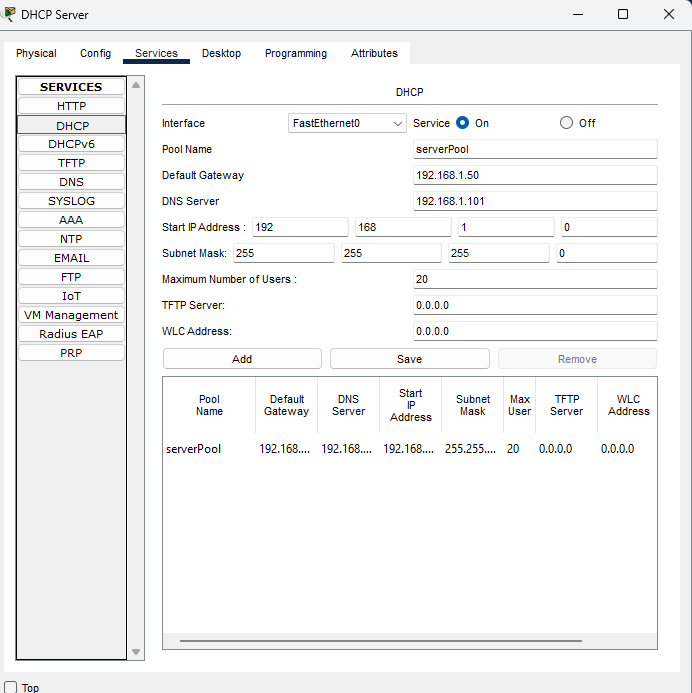
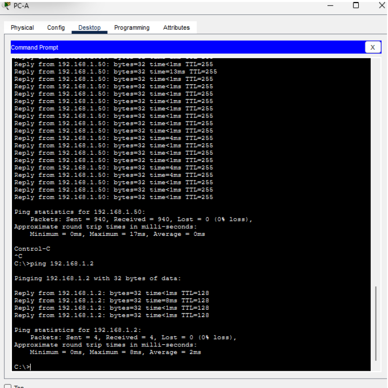
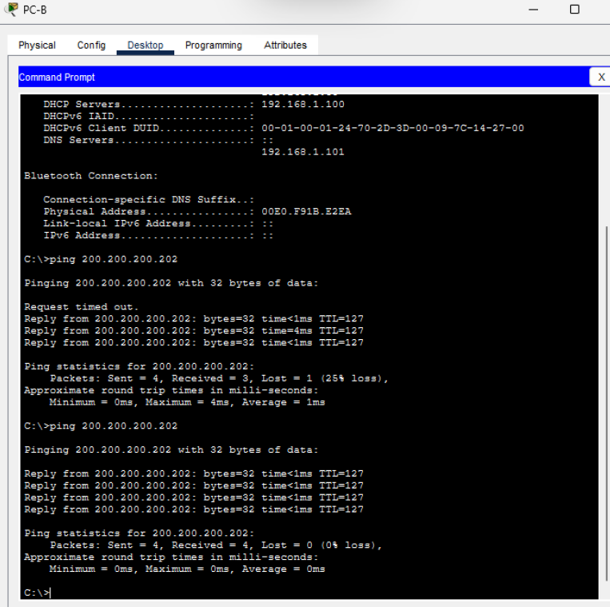
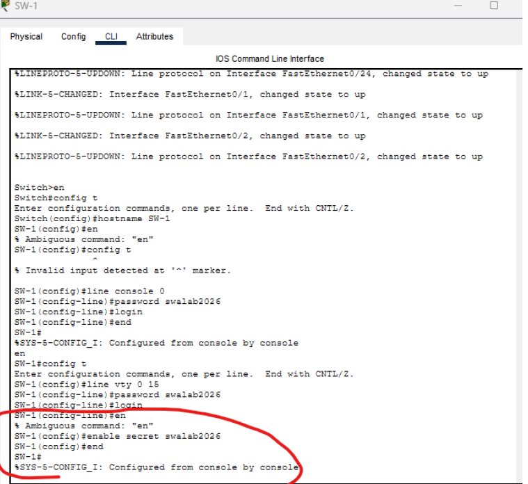
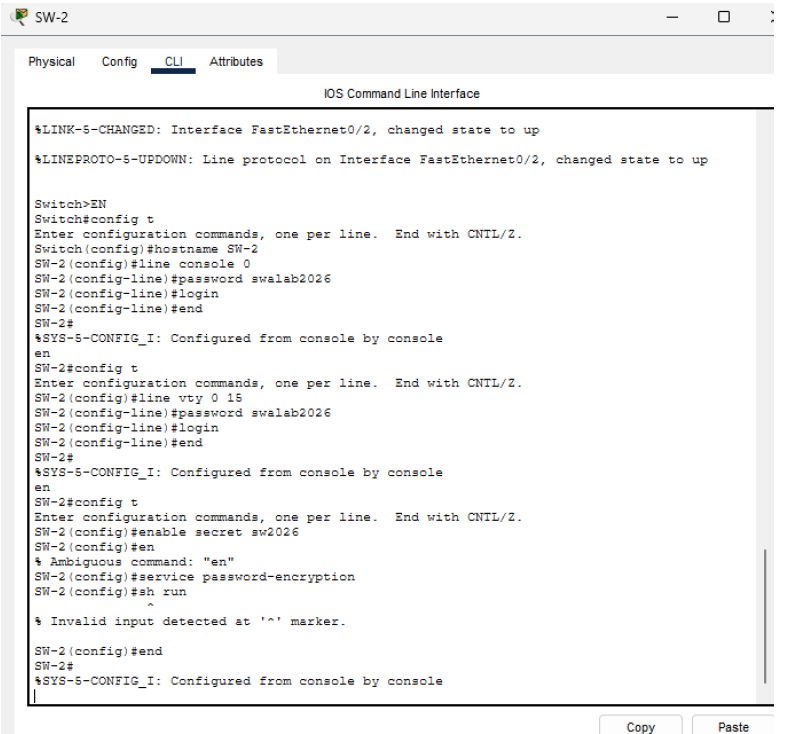
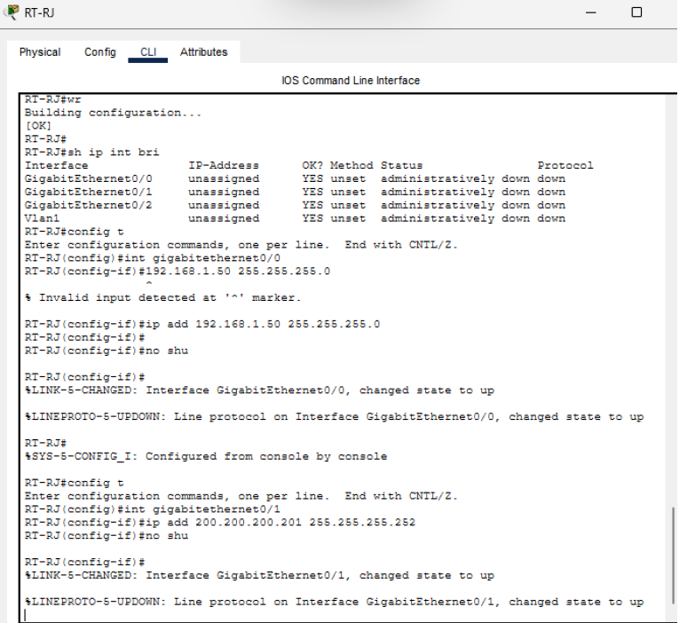
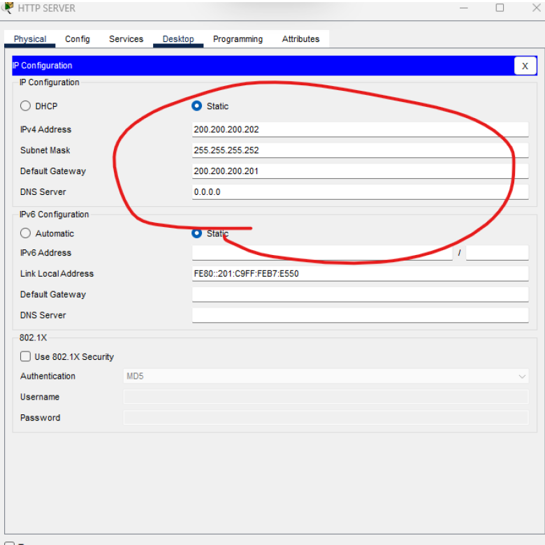
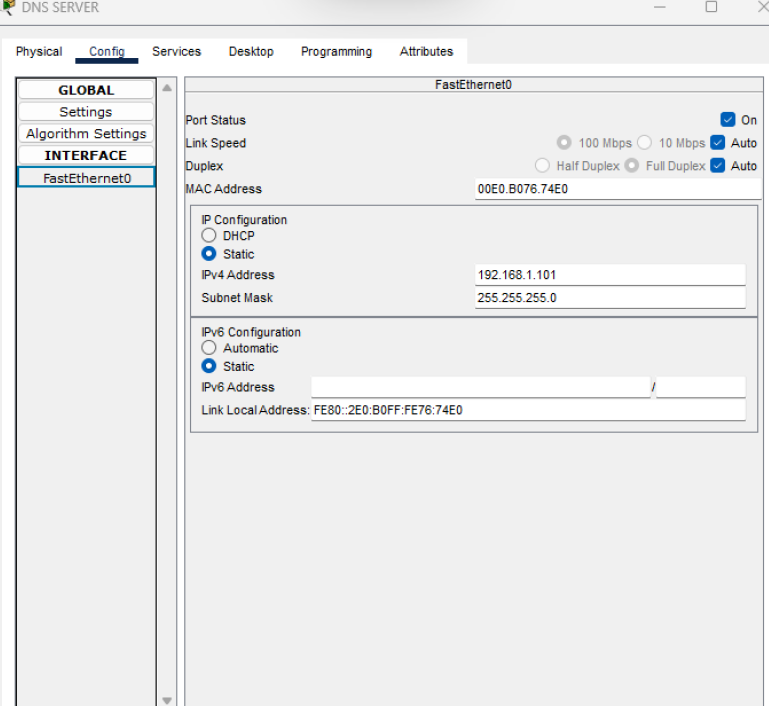
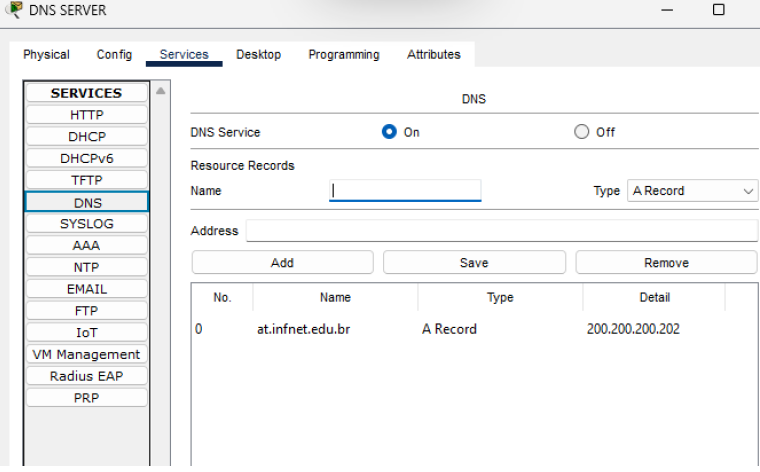
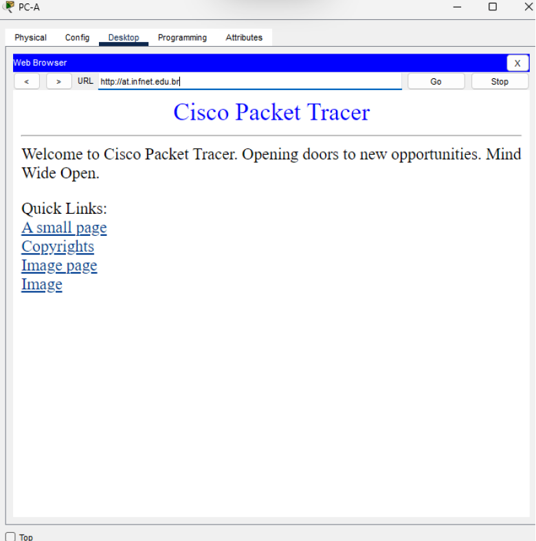

 # # Corporate Network Lab — Cisco Packet Tracer

A corporate network simulation developed as part of my Computer Networks studies at Infnet.

This project demonstrates basic network infrastructure configuration, switching, routing, and application-layer services using Cisco Packet Tracer.

## Objectives

- Configure Cisco switches and a router using Cisco IOS.
- Implement IPv4 addressing and default gateways.
- Configure DHCP for automatic IP address assignment.
- Configure DNS name resolution.
- Enable HTTP access to a web server.
- Test connectivity between hosts and servers.

## Technologies and Protocols

- Cisco Packet Tracer
- Cisco IOS
- IPv4
- Ethernet and ARP
- DHCP
- DNS
- HTTP
- ICMP (ping)

## Network Addressing

| Device | Interface | IP Address | Subnet Mask |
|---|---|---|---|
| DHCP Server | FastEthernet0 | 192.168.1.100 | 255.255.255.0 |
| DNS Server | FastEthernet0 | 192.168.1.101 | 255.255.255.0 |
| SW-1 | VLAN 1 | 192.168.1.200 | 255.255.255.0 |
| SW-2 | VLAN 1 | 192.168.1.201 | 255.255.255.0 |
| RT-RJ | G0/0 | 192.168.1.50 | 255.255.255.0 |
| RT-RJ | G0/1 | 200.200.200.201 | 255.255.255.252 |
| HTTP Server | FastEthernet0 | 200.200.200.202 | 255.255.255.252 |

## Implementation and Testing

The lab includes device configuration, DHCP address assignment, DNS record configuration, HTTP service activation, and connectivity tests between PCs and the web server.

Screenshots and test evidence are included in this repository.

## Project Files

- `AtDeFundamentosDeRede.pkt` — Cisco Packet Tracer simulation.
- Screenshots — Evidence of configurations and connectivity tests.

## Learning Outcomes

This project helped me practice network addressing, switching, routing, DHCP, DNS, HTTP, and troubleshooting.

These fundamentals are important for understanding network communication and building a foundation for cybersecurity.

---

**João Viana:** Computer Networks student at Infnet

## Implementation and Testing

### 1. Network Topology

The network topology was designed in Cisco Packet Tracer to simulate a corporate environment with client devices, switches, a router, and dedicated network servers.

The switches provide connectivity between devices within the local network, while the router connects the internal network to a separate network containing the HTTP server. This design demonstrates how network devices work together to enable communication between clients and services.

### 2. DHCP Server Configuration

The DHCP (Dynamic Host Configuration Protocol) server was configured with the static IPv4 address 

DHCP automatically assigns network configuration parameters to client devices, eliminating the need to configure each computer manually. The DHCP pool was configured to distribute IPv4 addresses and provide the appropriate subnet mask, default gateway, and DNS server address.

In this lab, the default gateway allows clients to communicate with devices outside their local subnet, while the DNS server address allows them to resolve domain names into IP addresses.

This configuration demonstrates how centralized address management simplifies network administration and reduces manual configuration errors.

### 3. Client IP Configuration

PC-A and PC-B were configured to obtain their IPv4 settings automatically through DHCP.

The `ipconfig /all` command was used to verify the assigned IP addresses, subnet mask, default gateway, and DNS server.

The subnet mask identifies which portion of an IPv4 address represents the network and which portion identifies the host. The default gateway provides the next hop for traffic destined for other networks, and the DNS server resolves domain names into IP addresses.

These checks confirmed that the client devices received their network configuration and were ready for connectivity testing.

### 4. Switch Configuration

SW-1 and SW-2 were configured using Cisco IOS commands. Their management interfaces were assigned static IPv4 addresses on VLAN 1, allowing the switches to be identified and accessed for management within the lab network.

The configuration also included device hostnames, passwords, encrypted password settings, and login banners.

Switches operate primarily at Layer 2, forwarding Ethernet frames based on MAC addresses. Their role in this topology is to provide local connectivity between network devices.

### 5. Router Configuration

The RT-RJ router was configured with two IPv4 interfaces:

- **G0/0 —  Connects to the internal network and serves as the default gateway for client devices.
- **G0/1 —  Connects to the separate network containing the HTTP server.

The router enables communication between different IP networks by forwarding packets according to its routing table. When a client sends traffic to a destination outside its local subnet, the packet is forwarded to the default gateway for routing.

The router was also configured with basic device identification and security settings through Cisco IOS.

### 6. HTTP Server Configuration

The HTTP server was assigned the static IPv4 address `200.200.200.202/30` and configured to provide a web service.

HTTP was enabled so that client devices could access the hosted web page through a browser. The server is located on a different IP network from the clients, allowing the lab to demonstrate communication through the router rather than only within the local network.

### 7. DNS Server Configuration

The DNS server was assigned the static IPv4 address `192.168.1.101/24`.

DNS (Domain Name System) translates human-readable domain names into IP addresses. An A record was created for `at.infnet.com.br`, pointing to the HTTP server at `200.200.200.202`.

This allows clients to access the web service using a domain name instead of having to remember the server's IP address.

DNS and HTTP serve different purposes: DNS resolves the name to an IP address, while HTTP is used to request and deliver the web content.

### 8. Connectivity Testing

Connectivity was tested using the `ping` command to verify IP-level communication between the client devices and the relevant network destinations.

Successful ping responses indicate that ICMP echo requests and replies can traverse the network between the tested devices. These tests help validate addressing and connectivity, although they do not independently prove that every application service is working correctly.

### 9. Web Access Validation

Finally, the domain `at.infnet.com.br` was entered into the web browser on both client PCs.

Successful access to the hosted page validated the interaction between multiple network components: DHCP provided client addressing, DNS resolved the domain name, and the router forwarded traffic to the HTTP server on the separate network.

This end-to-end test demonstrated that the configured network services worked together to provide access to an application hosted outside the clients' local subnet.

