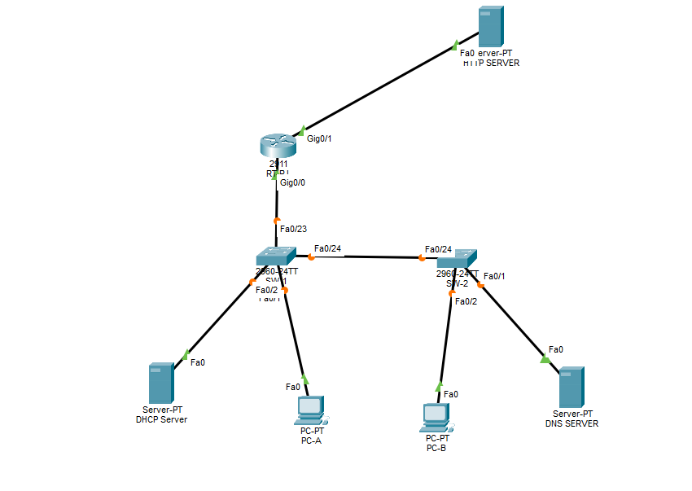

 # # Corporate Network Lab — Cisco Packet Tracer

A corporate network simulation developed as part of my Computer Networks studies at Infnet.

This project demonstrates basic network infrastructure configuration, switching, routing, and application-layer services using Cisco Packet Tracer.

## Objectives

- Configure Cisco switches and a router using Cisco IOS.
- Implement IPv4 addressing and default gateways.
- Configure DHCP for automatic IP address assignment.
- Configure DNS name resolution.
- Enable HTTP access to a web server.
- Test connectivity between hosts and servers.

## Technologies and Protocols

- Cisco Packet Tracer
- Cisco IOS
- IPv4
- Ethernet and ARP
- DHCP
- DNS
- HTTP
- ICMP (ping)

## Network Addressing

| Device | Interface | IP Address | Subnet Mask |
|---|---|---|---|
| DHCP Server | FastEthernet0 | 192.168.1.100 | 255.255.255.0 |
| DNS Server | FastEthernet0 | 192.168.1.101 | 255.255.255.0 |
| SW-1 | VLAN 1 | 192.168.1.200 | 255.255.255.0 |
| SW-2 | VLAN 1 | 192.168.1.201 | 255.255.255.0 |
| RT-RJ | G0/0 | 192.168.1.50 | 255.255.255.0 |
| RT-RJ | G0/1 | 200.200.200.201 | 255.255.255.252 |
| HTTP Server | FastEthernet0 | 200.200.200.202 | 255.255.255.252 |

## Implementation and Testing

The lab includes device configuration, DHCP address assignment, DNS record configuration, HTTP service activation, and connectivity tests between PCs and the web server.

Screenshots and test evidence are included in this repository.

## Project Files

- `AtDeFundamentosDeRede.pkt` — Cisco Packet Tracer simulation.
- Screenshots — Evidence of configurations and connectivity tests.

## Learning Outcomes

This project helped me practice network addressing, switching, routing, DHCP, DNS, HTTP, and troubleshooting.

These fundamentals are important for understanding network communication and building a foundation for cybersecurity.

---

**João Viana:** Computer Networks student at Infnet

### 1. Network Topology

The topology connects the router, switches, client PCs, and network servers.

### 2. DHCP Configuration

The DHCP server provides automatic IPv4 configuration to client devices.

### 3. Client IP Configuration

The client PCs obtain their network settings through DHCP.

**PC-A**

**PC-B**

### 4. Switch Configuration

SW-1 and SW-2 are configured with management IP addresses and basic access protection.

### 5. Router Configuration

RT-RJ provides connectivity between the internal network and the HTTP server network.

### 6. DNS and HTTP Services

The DNS record `at.infnet.com.br` resolves to the HTTP server address.

### 7. Connectivity Tests

Ping tests are used to validate communication between client PCs and the HTTP server.

### 8. HTTP Access

The client PCs access the web server using the configured DNS name.

